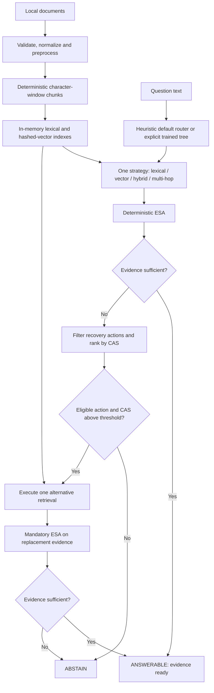

# EAR-RAG: Evidence-Aware Adaptive Retrieval with Selective Query Recovery

EAR-RAG is a local Python research prototype that selects a retrieval strategy,
assesses the returned evidence, and decides whether one additional retrieval is
justified. Its CLI and optional Streamlit dashboard expose routing decisions,
evidence scores, recovery arithmetic, retrieved passages and actual retrieval work.

The implementation ends at **evidence readiness or abstention**. `ANSWERABLE`
(internally `final_state="generate"`) means the evidence passed the deterministic
Evidence Sufficiency Assessment (ESA). **No natural-language answer is generated.**
Answer correctness and hallucination reduction remain research objectives.

## Quick start

Requirements: **Python 3.11+**; the existing workspace uses **Python 3.12.4**.
Run commands from the repository root. No API key, GPU, model download or external
vector database is needed for the current backends.

### New checkout: Windows PowerShell

```powershell
Set-Location C:\ear-rag  # replace with your checkout path
py -3.12 -m venv .venv
.\.venv\Scripts\python.exe -m pip install -e .
.\.venv\Scripts\python.exe -m pytest -q
.\.venv\Scripts\python.exe -m ear_rag.evaluate_initial --smoke
```

Use another installed Python version >=3.11 if needed. Calling the environment's
Python directly avoids a PowerShell activation-policy dependency.

### New checkout: Linux/macOS

```bash
cd /path/to/ear-rag
python3 -m venv .venv
.venv/bin/python -m pip install -e .
.venv/bin/python -m pytest -q
.venv/bin/python -m ear_rag.evaluate_initial --smoke
```

`pip install -e .` reads `requirements.txt` via `pyproject.toml`. Core
dependencies include PyYAML, PyArrow, pytest, mypy and pre-commit. Streamlit is
separate in `requirements-dashboard.txt`. This is an editable-checkout workflow:
configuration and fixture paths resolve from the source tree. Python 3.11 and
standalone wheel deployment have not been verified.

The smoke command uses a tracked synthetic fixture, compares fixed retrieval
with initial routing, and disables recovery. It needs no external datasets;
its scores are integration checks, not research benchmark results.

### Existing workspace

The local environment is named `ai-proj-new`:

```powershell
.\ai-proj-new\Scripts\python.exe -m ear_rag.evaluate_initial --smoke
.\ai-proj-new\Scripts\python.exe -m pytest -q
```

The remaining Windows examples use that environment. Substitute
`.\.venv\Scripts\python.exe` for a new checkout, or `.venv/bin/python` on
Linux/macOS. Dataset-dependent commands require the files listed below.

## Implemented architecture

The project separates data preparation, runtime evidence control and offline
evaluation. Core dataclasses and `Protocol` interfaces define component boundaries.



Gold answers, support annotations and decomposition labels remain outside runtime
routing, retrieval, ESA and recovery. Offline evaluators use them to score returned
evidence. The dashboard presents the existing controller's trace.

### Data preparation and indexing

- Native readers validate labelled HotpotQA and MuSiQue inputs and separate
  runtime documents from evaluation labels. Normalization tools also handle
  local 2WikiMultihopQA and NQ-Open inputs.
- Preprocessing normalizes whitespace, skips empty documents and detects
  conflicting duplicate document IDs.
- `DocumentChunker` uses **400-character windows with 50-character overlap**
  by default. Chunks preserve document identity, metadata, offsets and stable IDs.
- `RetrievalDataPipeline` persists examples, documents and chunks as JSONL with
  versioned manifests. Reloading saved chunks rebuilds lexical statistics without
  re-chunking. Live demos build fresh in-memory indexes.

### Query analysis and initial routing

The default `query_features_v1` policy extracts query-text signals such as exact
anchors, conceptual wording, mixed requirements and explicit dependencies.
Configured heuristic scores favor lexical, vector, hybrid or multi-hop retrieval
respectively. These suitability scores are not probabilities.

Exactly one initial strategy is selected. Low scores, ambiguous margins or
unavailable choices can use the configured lexical fallback. Decisions record
features, scores, reason, fallback information and routing latency. Disabling
`query_analysis.enabled` uses `retrieval.backend` directly.

Optional `query_tree_v1` inference uses a deterministic CART/Gini decision tree
over the existing query-text features. It requires an explicit artifact path,
SHA-256 and compatible schema. Invalid artifacts or an unavailable selected backend
raise an error. The default remains the heuristic router.

### Four retrieval backends

| Backend | Implementation | Underlying calls per invocation |
| --- | --- | --- |
| `local_lexical` | Dependency-free BM25-inspired term scoring | 1 |
| `vector_flat` | Flat cosine search over deterministic hashed-token vectors; default 64 dimensions | 1 |
| `hybrid` | Normalized lexical/vector score fusion; default weights 0.5/0.5 | 2 |
| `multihop` | Bounded lexical retrieval with expansion from the first result's first eight tokens | Up to `max_hops` (default 2) |

Vector retrieval has no learned embedding model. Multi-hop uses lexical expansion,
retaining first-seen chunks in hop order before the final top-k limit. A full
first hop can occupy every returned position. It does not perform LLM decomposition.

### Evidence Sufficiency Assessment (ESA)

`DeterministicEvidenceAssessor` computes four observable proxies:

| Component | Computation |
| --- | --- |
| Relevance | Maximum positive retrieval score `r`, transformed to `r / (1 + r)`; otherwise 0 |
| Coverage | Fraction of distinct query tokens found in retrieved chunk text |
| Support | `coverage * min(1, returned_chunk_count / 2)` |
| Consistency | Distinct normalized chunk texts / returned chunk count; 0 for no chunks |

The overall score is the weighted mean, with **0.25 per component** by default:

- **Sufficient:** ESA >= 0.70.
- **Uncertain:** 0.40 <= ESA < 0.70.
- **Insufficient:** ESA < 0.40.

Both uncertain and insufficient evidence enter recovery consideration. These
signals measure retrieval scores, lexical coverage and duplication. They do not
verify factual support or contradictions; ESA is not a calibrated probability.

### Cost-aware selective recovery (CAS)

Recovery uses the present evidence state and nominal next-action work:

```text
deficiency = 1 - current_ESA
cost = max(0.05 * calls + 0.01 * returned_chunks + 0.001 * latency_ms, 0.05)
CAS = deficiency * binary_suitability / cost
```

Candidates must be configured, callable, unattempted and suitable. Binary
suitability checks an observable gap: missing query tokens, duplicate normalized
evidence, or fewer than `min(top_k, 2)` chunks. Multi-hop additionally requires a
dependency signal and a suitable partial lexical seed. Suitability describes
applicability, not predicted success.

The policy ranks eligible actions with deterministic tie-breaking and executes
the best only when **CAS > threshold** (default **1.0**). Equality does not qualify.

| Candidate | Nominal calls | Returned chunks | Assumed latency (ms) | Incremental cost |
| --- | ---: | ---: | ---: | ---: |
| Lexical / vector | 1 | 5 | 10 | 0.11 |
| Hybrid / multi-hop | 2 | 5 | 20 | 0.17 |

These are abstract work assumptions, not measured latency predictions or money.
The controller executes **at most one recovery retrieval**, reassesses the new
evidence, then returns `ANSWERABLE` or `ABSTAIN`. Recovery evidence **replaces**
the initial context; the contexts are not combined. Recovery can worsen ESA or
annotated support coverage.

Actual calls, returned context chunks and retrieval-only latency are recorded
separately. Composite backends include child calls; child passages and final
context chunks are separate quantities. Routing latency is separate, and loading/
indexing are excluded from retrieval latency.
See [the exact CAS rules](docs/deterministic_cas.md).

## Run the local dashboard

Install the optional UI dependency and launch:

```powershell
.\ai-proj-new\Scripts\python.exe -m pip install -r requirements-dashboard.txt
.\ai-proj-new\Scripts\python.exe -B -m streamlit run src/ear_rag/dashboard.py --server.address 127.0.0.1 --browser.gatherUsageStats false
```

Open **http://127.0.0.1:8501**. Stop with **Ctrl+C**.

- **Live Query Demo:** runs selected native MuSiQue dev questions with fresh
  indexes/controller state. Shows routing, evidence, ESA components, candidate
  eligibility, CAS arithmetic, recovery, reassessment and final status. Before/
  after views show new and overlapping parent paragraphs.
- **Benchmark Results:** reads saved HotpotQA, MuSiQue Phase 5 and Phase 6A
  reports without rerunning experiments.

The live tab requires
`data/raw/musique/official_v1_0/musique_ans_v1.0_dev.jsonl`.
Benchmark groups require saved directories referenced by `dashboard_data.SOURCES`
under `outputs/`. Missing files are reported explicitly. These ignored files are
not supplied by cloning the repo or installing Streamlit.

Two documented real-data examples demonstrate successful recovery and executed
recovery followed by abstention. See the
[internal review demo guide](docs/internal_review_demo_guide.md) for IDs, source
hashes, evidence and replay instructions.

## Run the command-line demo

The CLI supports **HotpotQA** and **2WikiMultihopQA** normalized inputs.
It does not accept `--dataset musique`; use the dashboard/native API for MuSiQue.
Supply the corresponding files first:

| Dataset | Runtime examples | Separate evaluation records |
| --- | --- | --- |
| `hotpotqa` | `data/processed/hotpotqa_normalized.jsonl` | `data/processed/evaluation/hotpotqa_evaluation.jsonl` |
| `2wiki` | `data/processed/2wiki_normalized.jsonl` | `data/processed/evaluation/2wiki_evaluation.jsonl` |

```powershell
# Interactive menu: compare, controller, evidence, small evaluation, exit
.\ai-proj-new\Scripts\python.exe -m ear_rag.demo --dataset hotpotqa

# Compare all four retrieval strategies for one question
.\ai-proj-new\Scripts\python.exe -m ear_rag.demo --dataset hotpotqa --mode compare --index 0

# Run initial retrieval, ESA and bounded recovery
.\ai-proj-new\Scripts\python.exe -m ear_rag.demo --dataset hotpotqa --mode ear-rag --index 0

# Supplied text against the selected normalized dataset corpus
.\ai-proj-new\Scripts\python.exe -m ear_rag.demo --dataset hotpotqa --mode ear-rag --index 0 --query-text "Where was the author born?"

# Show flags without loading data
.\ai-proj-new\Scripts\python.exe -m ear_rag.demo --help
```

Indices are zero-based. In the interactive menu, run comparison or the controller
before selecting **View Retrieved Evidence**; it uses the current process's last
results. CLI demos index pooled normalized documents across loaded examples.
Native condition evaluation builds a separate candidate corpus per question;
the two workflows' scores are not interchangeable.

## Configuration

Defaults live in [configs/config.yaml](configs/config.yaml). The demo/dashboard
load this file, but use their own explicit dataset paths. Changing `data.dataset`
alone does not change those inputs.

| Setting | Default / purpose |
| --- | --- |
| `data.dataset` | `fixture`, for the configurable persistent data pipeline |
| `query_analysis.enabled`, `.policy` | `true`, `query_features_v1` |
| `query_analysis.fallback_backend` | `local_lexical` |
| `query_analysis.minimum_score`, `.minimum_margin` | 1.0, 0.25 |
| `retrieval.backend` | `local_lexical` when routing is disabled |
| `retrieval.default_top_k`, `.max_top_k` | 5, 20 |
| `chunking.size`, `.overlap` | 400, 50 characters; used by current backend factory |
| `vector.dimensions` | 64 hashed-token dimensions |
| `hybrid.lexical_weight`, `.vector_weight` | 0.5, 0.5 |
| `multihop.max_hops` | 2 |
| `evidence_assessment.sufficient_threshold`, `.uncertain_threshold` | 0.70, 0.40 |
| `recovery.max_recovery_rounds` | 1; 0 disables recovery |
| `recovery.max_retrieved_chunks` | 20; policy budget guard before recovery |
| `recovery.cost_awareness.policy` | `evidence_sufficiency_cas_v1` |
| `recovery.cost_awareness.cost_efficiency_threshold` | 1.0, strict comparison |
| `generation.enabled`, `models.generator` | `false`, `null`; no runtime generator |

`recovery.max_attempts` is a compatibility alias; current factories use
`max_recovery_rounds`. Increasing that limit does not make the current pipeline
a multi-round loop. Nominal recovery call budgets must match backend structure,
including the configured multi-hop hop count.

## Data and evaluation workflow

Tracked fixtures in `data/fixtures/` support tests and smoke checks. Raw datasets,
processed corpora, indexes and experiment outputs are ignored by Git. Dependency
installation does not download or prepare them.

Native HotpotQA/MuSiQue evaluation uses **question-scoped candidate pools**,
rather than full-Wikipedia retrieval. Runtime projections retain question text,
document text and safe source identity. Answers, supporting facts, support flags
and decomposition annotations stay evaluation-only. MuSiQue uses native paragraph
IDs to preserve distinct evidence with repeated titles. NQ-Open still needs a
separate retrieval corpus.

`ear_rag.condition_evaluation.evaluate_conditions(dataset, cases, config)`
runs six conditions on the same requested cases with fresh indexes/controller state:

1. Fixed lexical, no recovery.
2. Fixed vector, no recovery.
3. Fixed hybrid, no recovery.
4. Fixed multi-hop, no recovery.
5. Query-aware initial routing, no recovery.
6. Adaptive controller with configured recovery.

Reports distinguish requested, evaluated, failed and excluded cases. Metrics
include Hit@5, supporting-document/paragraph Recall@5, applicable HotpotQA sentence
coverage, recovery/abstention and actual work. MuSiQue sentence coverage is
unavailable, rather than substituted with paragraph recall. Parent metrics
deduplicate parent IDs among the **first five returned chunks**.

Reports use JSON/JSONL/CSV with configuration and provenance metadata; experiment
drivers freeze source/input hashes. Read the
[evaluation protocol](docs/evaluation_protocol.md) for validation, exclusions,
exposure checks and splits. Preparation uses APIs such as `read_hotpotqa`,
`read_musique`, `NormalizedCorpusBuilder` and `RetrievalDataPipeline`.

### Development evaluation commands

The initial-routing evaluator accepts an explicit config and saves reports:

```powershell
.\ai-proj-new\Scripts\python.exe -m ear_rag.evaluate_initial --dataset hotpotqa --examples 20 --sampling seeded --seed 1729 --config configs/config.yaml --output-dir outputs/local-initial-routing
```

It requires normalized CLI inputs and disables recovery. Its pooled-corpus
workflow differs from native six-condition evaluation.

The MuSiQue driver provides `run` and `verify` modes:

```powershell
.\ai-proj-new\Scripts\python.exe -m ear_rag.musique_experiment --help
```

A new `run --output outputs/<new-unique-name>` requires local native inputs and a
frozen development protocol; it rejects existing directories. Historical Phase 5
`verify` checks frozen source hashes and needs the matching Phase 5 implementation.
Later Phase 6A changes can make that historical check fail even when saved reports
remain readable. Preserve existing experiment directories.

### Optional trained routing

Phase 6A fits deterministic trees on official MuSiQue train and selects on dev.
Offline targets prefer paragraph recall, then fewer retrieval calls, then a fixed
backend tie-break. Inference uses query-text features only.

The selected artifact has **depth 0 and always chooses lexical**. It matches
fixed lexical on dev and shows no query-dependent routing benefit. The default
controller still uses `query_features_v1`.

If saved Phase 6A artifacts are present, inference can load their explicit settings:

```python
from ear_rag.config.loader import load_config
from ear_rag.routing.learned import make_router

config = load_config(
    "outputs/phase6a-router-development-20261022T155210Z-95732e1d/selected_config.json"
)
router = make_router(config["query_analysis"])
decision = router.select(
    "Where was the author born?",
    ("local_lexical", "vector_flat", "hybrid", "multihop"),
)
print(decision.selected_strategy)
```

Supply the same `query_analysis` settings to `RetrievalControlPipeline` for
controller use. Moving the model requires updating its path and retaining its
expected checksum. The research training entry point is
`python -m ear_rag.router_training --output outputs/<new-prepared-directory>`.
It requires official local train/dev files, acquisition manifests and a prepared
output directory containing `PROTOCOL.md`. Training is separate from setup and
dashboard use.

## Current results and limits

Completed evaluations are **development/internal** with exposure limitations.
They do not establish unseen generalization, answer correctness, hallucination
reduction or superiority over published systems.

The saved MuSiQue official-dev study evaluated 2,417 questions with zero
failures/exclusions:

| Condition | Paragraph Recall@5 | Underlying retrieval calls |
| --- | ---: | ---: |
| Fixed lexical | 0.479555 | 2,417 |
| Query-aware, no recovery | 0.437043 | 2,493 |
| Adaptive controller | 0.473900 | 2,810 |

Recovery improves recall over the heuristic router alone in this study, while
fixed lexical achieves higher recall with fewer calls. Phase 6A's constant router
also has dev recall 0.479555. These are evidence metrics.

The revised-CAS HotpotQA diagnostic run evaluated 497 of 500 requested exposed
questions, with three exclusions and no failures. Adaptive document recall rose
1.509 percentage points over query-aware/no-recovery, but stayed 1.811 points
below fixed lexical while using 40 more calls. Older expected-gain-policy reports
describe a previous controller and do not validate current CAS.

The **2026-10-22 protected-evaluation audit** recorded independent final evaluation
as blocked: verified protected support labels, compatible authorized scoring access
and sufficient candidate independence/prior-use evidence were not established.
No final benchmark ran. Dev used for model selection cannot be an independent test.

These local reports are under ignored `outputs/`; links need those directories:

- [MuSiQue development study](outputs/phase5-musique-development-internal-20261022T153801Z-cfdcea73/REPORT.md).
- [Revised-CAS HotpotQA diagnostic study](outputs/phase5-revised-cas-development-internal-known-exposure-20261022T125412Z-0e6adb98/REPORT.md).
- [Phase 6A router training and selection](outputs/phase6a-router-development-20261022T155210Z-95732e1d/REPORT.md).
- [Phase 6B protected-evaluation audit](outputs/phase6b-protected-evaluation-audit-20261022T161807Z-7e19b0ef/REPORT.md).

Future work includes learned semantic retrieval, calibrated evidence/control
policies, general query reformulation/decomposition, answer generation and
independent answer-level evaluation. Recovery enums and generator interfaces
do not imply those operations are implemented.

## Code structure

```text
ear-rag/
|-- src/ear_rag/
|   |-- config/                  # YAML loading and helpers
|   |-- core/                    # Dataclasses, enums and Protocol interfaces
|   |-- data/                    # Readers, normalization, validation, persistence
|   |   |-- hotpotqa*.py         # Reader, policy, split and evidence tools
|   |   `-- musique*.py          # Reader and paragraph evidence mapping
|   |-- retrieval/               # Chunking, lexical, vector, hybrid, multi-hop
|   |-- evidence/esa.py          # Four-component deterministic ESA
|   |-- routing/
|   |   |-- query_analysis.py    # Query-text features
|   |   |-- initial.py           # Default heuristic router
|   |   |-- learned.py           # Optional tree and strict artifact loading
|   |   |-- cost_awareness.py    # Suitability, nominal cost and CAS
|   |   |-- recovery.py          # Candidate selection and stopping rules
|   |   `-- pipeline.py          # Retrieval, ESA, recovery and reassessment
|   |-- demo.py                  # Normalized-data CLI and backend factory
|   |-- dashboard.py             # Optional Streamlit UI
|   |-- dashboard_data.py        # Trace views and saved report reader
|   |-- evaluate_initial.py      # Routing evaluator and fixture smoke CLI
|   |-- control_evaluation.py    # Native cases and offline gold scoring
|   |-- condition_evaluation.py  # Isolated six-condition comparison API
|   |-- evaluation_*.py          # Metrics, label resolution and serialization
|   |-- musique_experiment.py    # Frozen development run/verify driver
|   `-- router_training.py       # Official train/dev router development
|-- configs/config.yaml          # Tracked runtime defaults
|-- data/fixtures/               # Tracked deterministic test/smoke inputs
|-- data/{raw,processed,indexes}/ # Ignored local data and persisted artifacts
|-- outputs/                    # Ignored reports, models and traces
|-- tests/                      # Contract, data, retrieval, control, UI and eval
|-- docs/                       # Protocols, audits and demo guides
|-- pyproject.toml              # Package metadata; editable src layout
|-- requirements.txt            # Core dependency source
|-- requirements-dashboard.txt  # Optional pinned Streamlit
|-- PROGRESS.md                 # Historical implementation/verification record
`-- AGENT_HANDOFF.md            # Current checkpoint and continuation context
```

## Verification and troubleshooting

```powershell
.\ai-proj-new\Scripts\python.exe -m pytest -q
.\ai-proj-new\Scripts\python.exe -m pip check
git diff --check
```

Tests cover contracts, persistence, data validation/label isolation, retrieval,
routing, ESA/CAS, reassessment, abstention, evaluation accounting, learned
artifacts and dashboard behavior. Dashboard tests require optional Streamlit.
Passing software tests does not establish research effectiveness.

| Symptom | What to check |
| --- | --- |
| `No module named ear_rag` | Run `python -m pip install -e .` in the same environment. |
| `No module named streamlit` | Install `requirements-dashboard.txt` in that environment. |
| Missing normalized JSONL | Supply runtime and evaluation files above; use `evaluate_initial --smoke` for a data-independent check. |
| Dashboard missing data/reports | Supply native MuSiQue dev data or saved outputs; dependency installation does not create them. |
| Trained router cannot load | Check explicit settings, artifact path, SHA-256 and feature schema. |
| Recovery runs but returns `ABSTAIN` | Check actual post-recovery ESA; CAS acceptance does not guarantee sufficiency. |

Further reading: [routing policy](docs/initial_routing.md),
[CAS specification](docs/deterministic_cas.md),
[evaluation protocol](docs/evaluation_protocol.md),
[query-analysis validation](docs/query_analysis_validation.md),
[MuSiQue audit](docs/musique_dataset_audit.md), and
[internal review demo guide](docs/internal_review_demo_guide.md).
